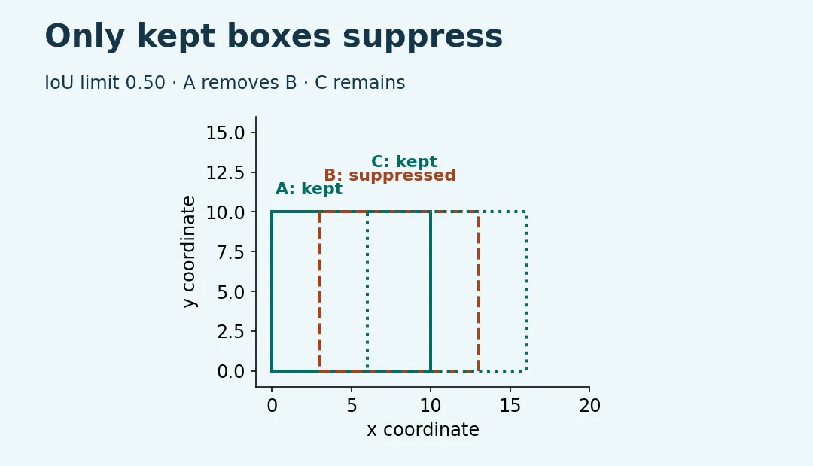
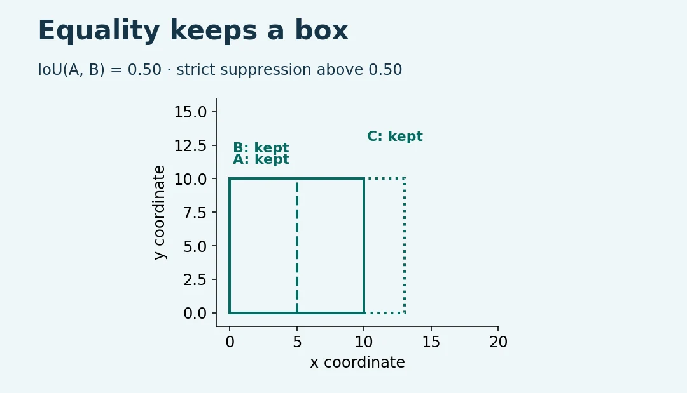

# Non-Maximum Suppression for Object Detection

Build a small, explainable NMS tool for already-generated boxes. The three JSON fixtures are synthetic. No detector, GPU, camera or third-party package is needed.


1. Install a supported Python 3.11 or newer from [Python.org](https://www.python.org/downloads/).
2. Select **Code**, **Download ZIP** on GitHub. Extract the folder and open a terminal in it.
3. Check `python3 --version`. On Windows use `py -3` instead of `python3`.

```sh
python3 nms.py examples/overlap.json --iou 0.5 --min-score 0.5
python3 nms.py examples/overlap.json --iou 0.5 --min-score 0.5 --agnostic
python3 nms.py examples/chain.json --iou 0.5
python3 nms.py examples/boundary.json --iou 0.49 --min-score 0.5
python3 -m unittest discover -s tests -v
```

Expect kept IDs A,C; A; A,C; and A,C in that order. At IoU threshold 0.50 the boundary example keeps A,B,C. The output also lists the reason for each decision and which kept box suppressed a duplicate. A score equal to the minimum survives filtering. An IoU equal to the threshold survives suppression. Tied scores use input order in this implementation.

Use boxes `[x_min,y_min,x_max,y_max]` with positive width and height. Supply unique string IDs, a string label and a score in [0,1] for each row. If overlap looks wrong, check whether the upstream exporter uses width and height or normalized coordinates, and use one coordinate scale per image. Process different frames separately. Class-aware mode compares labels literally; names that differ in case are different classes here.





The editable SVG and plotting code use the sample detections and decision trace. To regenerate, install Matplotlib and Pillow in a separate environment and run `python3 diagrams/render.py`.

This is greedy hard NMS for small inputs, not a drop-in production detector. It can remove a legitimate nearby object. Test thresholds on labeled holdout images from the intended application. See [Torchvision NMS](https://docs.pytorch.org/vision/stable/generated/torchvision.ops.nms.html) and [class-aware NMS](https://docs.pytorch.org/vision/stable/generated/torchvision.ops.batched_nms.html).
